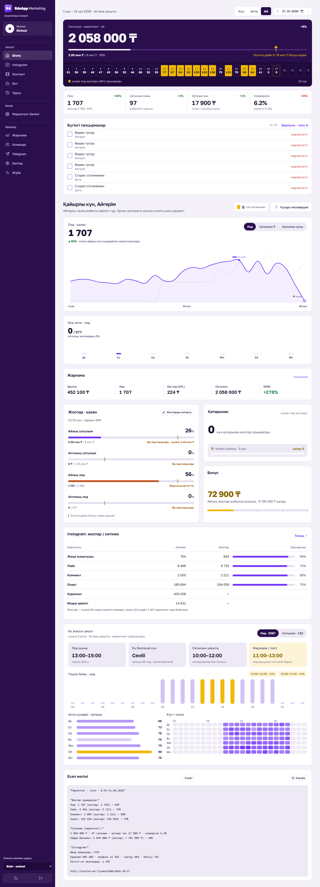
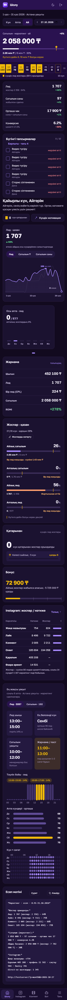

# EduApp Marketing — "Overview" home screen mockup

A high-fidelity, self-contained HTML mockup of the home ("Шолу / Overview") screen of an internal marketing analytics dashboard: monthly sales vs plan, daily lead calendar, KPI cards, team tasks, motivation widget with celebrations, lead/sales trend chart, ad spend & ROMI, plan progress, Instagram plan/fact table, best-time heatmaps and a copy-ready text report. Light and dark themes, desktop and mobile layouts.

| Desktop (light) | Mobile (dark) |
|---|---|
|  |  |

## Features

- **Single HTML file** — inline CSS and vanilla JS, Golos Text from Google Fonts; no build, no backend.
- **Themes** — light / dark via `data-theme` (`?theme=dark`, remembered in `localStorage`); `?freeze` disables animations for pixel-stable screenshots.
- **Responsive** — sidebar navigation on desktop, compact header + bottom tab bar on mobile; tables and tabs scroll horizontally with fade masks.
- **Data viz without libraries** — animated counters, plan progress bars with "should-be-today" markers, a daily lead calendar highlighting days over plan, smooth SVG trend chart (current vs previous month, tabs for leads / revenue / deals), hour-of-day and weekday × hour heatmaps with tooltips, sparklines.
- **Gamification** — motivation widget, streaks, gift/bonus progress, canvas-based celebration animation (confetti, fireworks, Web Audio tones) and a 1080×1920 "story" PNG export.
- **Text report** — a Telegram-ready monthly summary with a copy button.

## Tech stack

HTML5 · CSS (custom properties, grid, container-friendly layout) · vanilla JavaScript · inline SVG · Canvas 2D · Web Audio API.

## Project structure

```
home_mockup.html                 the mockup (rendered snapshot of the dashboard home page)
screenshots/home_{1440,390}_{light,dark}.png   rendered from the anonymized HTML
scripts/randomize_snapshot.py    randomizes every business number in the snapshot
```

## How to run (demo mode)

Open `home_mockup.html` in a browser (double-click), or serve it:

```bash
python -m http.server 8000      # → http://localhost:8000/home_mockup.html?theme=dark
```

Re-randomize the numbers (mapping is consistent across KPI cards, charts and the text report):

```bash
python scripts/randomize_snapshot.py home_mockup.html
```

> All data in this repository is randomly generated; brand names are anonymized. "EduApp Marketing", the logo, the team members' names and every metric (sales, leads, ad spend, plans, Instagram stats) are fictional.

## Қысқаша (KZ)

Маркетинг аналитикасы панелінің «Шолу» басты экранының толық HTML-мокапы: сатылым мен жоспар, лидтер күнтізбесі, KPI, тапсырмалар, жарнама, Instagram және жылу карталары.
Жарық / қараңғы тақырып, компьютер мен телефонға арналған нұсқалар, кітапханасыз SVG-графиктер мен анимациялар.
Іске қосу: `home_mockup.html` файлын браузерде ашыңыз.
Барлық сандар кездейсоқ жасалған, бренд пен адамдардың аттары өзгертілген.
